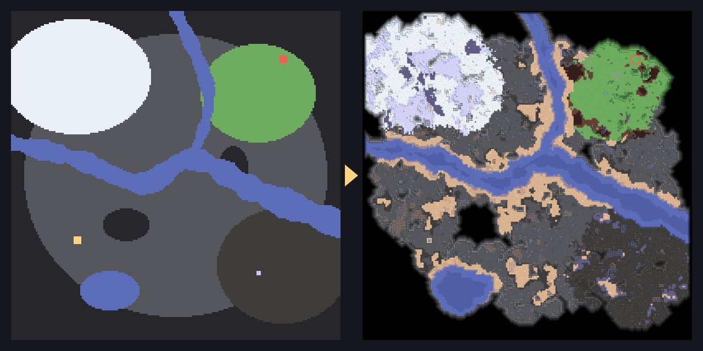

<div align="center">

# Mindscape

**Sketch-to-terrain map editor for [Mindustry](https://github.com/Anuken/Mindustry).**

Draw a rough layout and get a natural-looking, playable map, ready to open in the game.

[](LICENSE)


[](https://github.com/TousTarm/Mindustry_advanced_map_editor/issues)



</div>

## Overview

Mindscape is a standalone map editor and generator for the factory and tower-defense game
[Mindustry](https://mindustrygame.github.io/). It currently supports maps for the **Serpulo** planet;
**Erekir** support is planned.

Building an attractive map in the built-in editor takes a lot of manual work, and hand-painted maps tend to
look blocky: straight shorelines, hard biome borders, uniform floors. Mindscape separates **layout** from
**detail**. You decide where the land, rivers, lakes, rocks, core and enemy spawns go. The generator then
adds the kind of detail found on the official campaign maps:
- organic coastlines;
- deep and shallow water with beaches;
- blended biomes;
- rock formations, boulders and ore deposits.

Reroll anything you don't like, lock what you do, and finish by hand.

### Goals

- **Natural results.** Domain-warped noise, distance fields and cellular automata instead of straight lines.
- **Fast iteration.** Sketch, generate, reroll individual layers and edit tiles without leaving the editor.
- **Full game compatibility.** Exports standard `.msav` files that load directly in Mindustry.
- **Scriptable.** A command-line interface and a JSON map format for generating maps from code.

## Features

**Sketching**
- Brush, eraser, rectangle, ellipse, fill and river tools, with mirror and rotational symmetry for PvP maps.
- *Relative* shapes are hints that the generator is free to reshape.
- *Fixed* shapes are kept exactly as drawn.
- **Image import.** Draw a map in any paint program and load it as the sketch:
  - red lines become walls and small gaps in them are closed;
  - enclosed regions are classified as inside or outside automatically;
  - the image stays visible as an adjustable background.

**Generation**
- 12 biomes and 5 liquids (water, tainted water, slag, tar, cryofluid), with configurable depth and beaches.
- Rocks, boulders, vegetation and ore deposits. Starting ores are guaranteed near the core, and a walkable path from each spawn to the core is guaranteed too.
- Separate seeds for shapes, floors, rocks, ores and decoration, so you can reroll one layer at a time.
- Deterministic: the same sketch and seed always produce the same map.

**Editing**
- Tile-level painting of floors, walls, ores and decoration, using every block from the game.
- Edited tiles are locked automatically, so regenerating never overwrites manual work.
- Resize with anchoring, flip, undo/redo (including rerolls), grid overlay.
- Rendering uses the game's own sprites, including edge blending and wall shading.

**Files**
- Import and export of `.msav` (save format version 11).
- Projects (`.mindscape.json`) store the sketch, the parameters and the locks. The editor also autosaves in the browser.
- **Beautify.** Load an existing map, derive a sketch from it and regenerate it with natural detail.

## Getting started

Requirements: [Node.js](https://nodejs.org/) 18 or newer.

```bash
git clone https://github.com/TousTarm/Mindustry_advanced_map_editor.git
cd Mindustry_advanced_map_editor
npm install
npm run dev
```

Open **http://localhost:5178** in your browser.

To build a static version into `dist/`, run `npm run build`. To serve that build, run `npm run preview`.

### Using a map in the game

Click **Export .msav**. In Mindustry, open **Map Editor → Import Map** and choose the file. You can also copy
the file into the game's `maps` folder.

## Usage

1. **Sketch** (`Tab` switches modes).
   - Paint rough areas of biomes, rock and liquids.
   - Place the core, the enemy spawns and optional ore deposits.
   - Draw rivers with the River tool: click to add points, double-click to finish.
   - The map regenerates after each stroke.
2. **Tune** the generator in the right panel: edge warp, biome blending, beach width, water depth, rock
   density and ore amount. The reroll buttons regenerate a single layer.
3. **Edit** individual tiles. Lock regions you are happy with and keep rerolling the rest.
4. **Export** the map as `.msav`.

### Keyboard shortcuts

| Key | Action | Key | Action |
|---|---|---|---|
| `B` | Brush | `G` | Generate |
| `E` | Eraser | `Shift+G` | Generate with a new seed |
| `F` | Fill (`Shift`: replace on whole map) | `X` | Toggle relative / fixed |
| `L` | River | `[` / `]` | Brush size |
| `R` / `O` | Rectangle / ellipse | `H` | Sketch overlay |
| `C` / `S` | Core / spawn | `0` | Center view |
| `Ctrl+Z` / `Ctrl+Y` | Undo / redo | `Space`, right mouse | Pan |

## Command-line interface

```bash
node src/cli.js gen examples/river-valley.json --scale 4   # spec -> .msav + .png preview
node src/cli.js sketch examples/river-valley.json          # preview the layout only
node src/cli.js image drawing.png --width 200              # red-line drawing -> spec
node src/cli.js beautify map.msav                          # regenerate an existing map
node src/cli.js render map.msav --scale 4                  # render any map to PNG
node src/cli.js info map.msav                              # size, tags, block histogram
node src/cli.js help                                       # all commands and options
```

### Map spec

Maps are described in JSON:
- the size, a base biome and a seed;
- an ordered list of shapes (`fill`, `rect`, `circle`, `ellipse`, `polygon`, `path`), where later shapes paint over earlier ones;
- the core, the spawns and any ore deposits.

Coordinates are in tiles, with y pointing up from the bottom-left corner, the same as in Mindustry.

```json
{
  "name": "My Map", "width": 200, "height": 200, "base": "stone", "seed": 7,
  "shapes": [
    { "type": "fill", "label": "wall" },
    { "type": "circle", "label": "stone", "center": [100, 100], "r": 90 },
    { "type": "path", "label": "water", "points": [[0, 120], [90, 90], [200, 60]], "width": [6, 12] },
    { "type": "rect", "label": "wall", "rect": [120, 130, 20, 10], "fixed": true }
  ],
  "core": [40, 60],
  "spawns": [[160, 160]],
  "ores": [{ "ore": "ore-titanium", "center": [150, 40], "r": 6 }]
}
```

There are complete examples in [`examples/`](examples/). Run `node src/cli.js labels` to list every label
and generator parameter.

## Project structure

```
src/core/     generator, .msav reader/writer, renderer, sketch model (runs in Node.js and the browser)
src/node/     file I/O for the CLI
src/cli.js    command-line interface
web/          editor UI (Vite; generation runs in a Web Worker)
data/         block catalog and building templates extracted from Mindustry
public/       sprite atlas
scripts/      tools that rebuild data/ and the atlas from the Mindustry sources
examples/     example map specs
```

## Roadmap

- [ ] Erekir planet support
- [ ] Wave and map rules editor
- [ ] Placing buildings for different teams
- [ ] More biomes and palettes
- [ ] English UI (the editor interface is currently in Czech)

## Bug reports and feature requests

Found a bug, or a generated map that looks wrong? Please
[open an issue](https://github.com/TousTarm/Mindustry_advanced_map_editor/issues/new/choose). A good report includes:
- steps to reproduce;
- a screenshot;
- if possible, the project file (`.mindscape.json`) or the exported map.

Ideas and feature requests are welcome too.

Pull requests are welcome. For larger changes, please open an issue first so we can agree on the approach.

## License

Mindscape is released under the [MIT License](LICENSE). Copyright © 2026 TousTarm.

You are free to use, modify and redistribute it, including commercially. If you use or build on this project,
keep the license notice and **credit TousTarm as the original author**.

Game sprites (`public/atlas.png`) and block data (`data/`) are taken from
[Mindustry](https://github.com/Anuken/Mindustry) by Anuke and are subject to its license (GPL-3.0).
Mindscape is a fan project and is not affiliated with or endorsed by the Mindustry developers.
